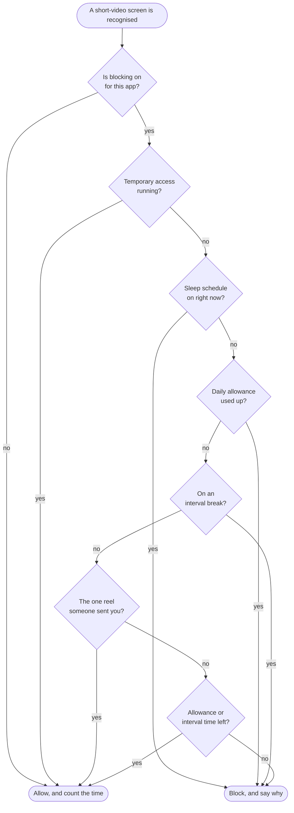
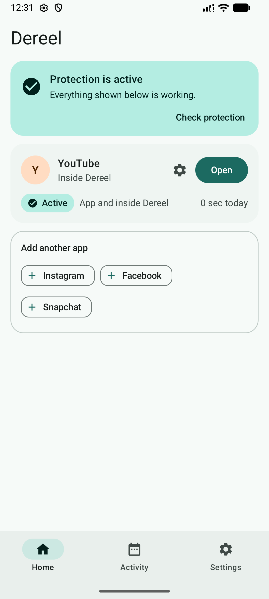
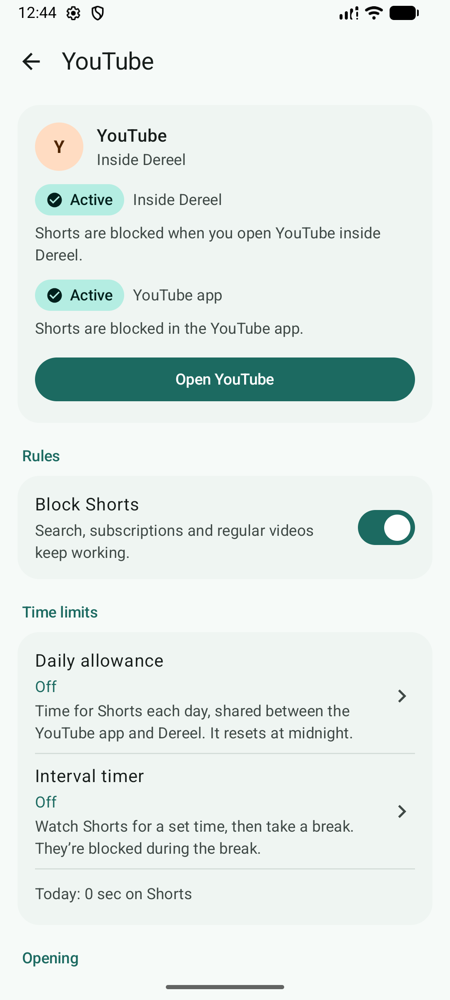
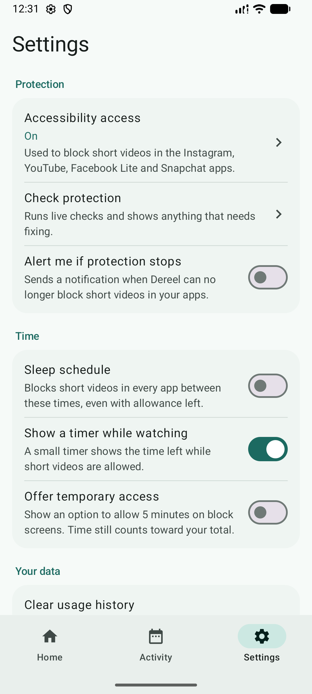
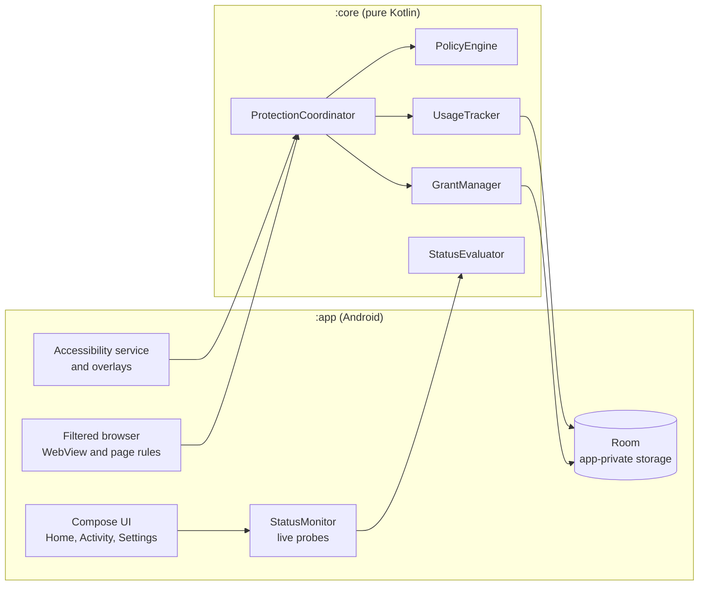

<div align="center">



<p>
  <a href="#what-it-does">What it does</a> ·
  <a href="#supported-apps">Supported apps</a> ·
  <a href="#time-rules">Time rules</a> ·
  <a href="#screens">Screens</a> ·
  <a href="#privacy">Privacy</a> ·
  <a href="#how-it-is-built">How it is built</a> ·
  <a href="#build-and-test">Build</a> ·
  <a href="#project-status">Status</a>
</p>

<p>
  
  
  
  
  
</p>

</div>

Dereel is an Android app that blocks short-video feeds (Instagram Reels, YouTube Shorts, Facebook
Reels and Snapchat Spotlight) and leaves the rest of each app alone. Messages, search, profiles
and regular videos keep working.

> [!IMPORTANT]
> This is an early build. Dereel recognises short-video screens by how each app is put together,
> so it depends on the app's version, and it has been tried on one phone so far. Read
> [Project status](#project-status) and [Known gaps](#known-gaps) before relying on it.

## What it does

<div align="center">

<br>
<sub>A schematic, not a screenshot. The timing is from one informal session, recorded in <a href="docs/COMPATIBILITY.md">docs/COMPATIBILITY.md</a>.</sub>
</div>

<br>

Dereel can protect an app in two ways. Both follow the same rules and share the same time limits.

| | In the installed app | Inside Dereel |
|---|---|---|
| **How it works** | An Accessibility service recognises the short-video screen, goes back once and tells you why. If the screen is still there, Dereel covers it. | You open the site in Dereel's own filtered browser. Short-video pages do not load, and recommendation shelves can be hidden. |
| **What it needs** | Accessibility access, which Dereel explains at the moment you turn it on | Signing in to the site inside Dereel |
| **Good for** | Keeping the app you already use | Apps you would rather not install, and an Instagram reel that someone sent you |

## Supported apps

| Platform | What is blocked | In its app | Inside Dereel |
|---|---|:-:|:-:|
| Instagram | Reels | ✅ | ✅ |
| YouTube | Shorts | ✅ | ✅ |
| Facebook | Reels, and the Video tab inside Dereel | Facebook Lite only | ✅ |
| Snapchat | Spotlight | ✅ | — |

TikTok, Instagram Lite and the regular Facebook app have been asked for and are not built yet.

<details>
<summary><b>App versions Dereel has been seen working with</b></summary>

<br>

All on one Pixel 9 running Android 17, in English, with debug builds. These were informal
sessions, not a formal test run.

| App | Version | What was seen |
|---|---|---|
| Instagram | 456.0.0.53.78 | The Reels viewer was recognised and Dereel pressed Back. One observation, made while another blocker was also switched on, so it needs repeating. |
| YouTube | 21.45.82 | The Shorts tab was blocked, and the sleep schedule, the interval timer and its break all behaved as set. |
| Facebook Lite | 539.0.0.7.106 | The reel player was recognised and left with one Back. One observation. |
| Snapchat | 14.32.0.54 | Spotlight was blocked five times out of five. Stories, Map, Chat and Camera were left alone. |

Inside Dereel, signing in to YouTube and to Instagram worked on that phone. The browser rules
for Instagram, YouTube and Facebook are unit-tested against shared route fixtures. Facebook
inside Dereel has not been tried signed in. Details are in
[docs/COMPATIBILITY.md](docs/COMPATIBILITY.md).

</details>

### Known gaps

<details>
<summary><b>What Dereel does not block</b></summary>

<br>

- **Reels inside the Instagram home feed.** Only the Reels tab and the full-screen viewer are
  blocked.
- **YouTube Shorts opened through a regular video link** (`/watch?v=…`) are not recognised as
  Shorts.
- **A short video in a floating window.** If short videos are allowed and you leave the app, it
  can keep one playing in picture-in-picture. Dereel does not see it, so that time is not counted
  or limited. Turning picture-in-picture off for that app in Android's settings closes the gap.
- **Facebook.** The regular Facebook app is not supported. In Facebook Lite, any video opened in
  the full-screen player is treated as a reel, and videos playing inside the feed are not
  blocked. Inside Dereel, a reel that plays in the feed without opening its own page is not
  blocked.
- **Snapchat.** Only the Spotlight feed is recognised. Stories and Discover videos are not
  blocked, and Snapchat cannot be opened inside Dereel because it has no mobile website.
- **Shared-video exceptions in the installed apps.** Watching one reel that someone sent you
  works only for Instagram inside Dereel.
- **Google sign-in inside Dereel** may be refused by Google. Dereel does not disguise its browser
  to get around that.
- **Languages.** The browser's "suggested" and "sponsored" filters match English labels only.
  Dereel does not claim to remove every ad.

The app's Help screen lists the same gaps.

</details>

## Time rules

<div align="center">

</div>

<br>

Blocking does not have to be all or nothing. Each platform has one balance, shared by the
installed app and Dereel's browser. All four rules are off until you turn them on.

| Rule | What it does | Choices |
|---|---|---|
| **Daily allowance** | A set amount of short-video time per day. It resets at midnight. | 5, 15 or 30 minutes, or any whole number from 1 to 180 |
| **Interval timer** | Watch for a set time, then take a break. Short videos are blocked during the break. | Watch for 5, 10, 15 or 30 minutes. Break for 15, 30, 60 or 120 minutes. |
| **Sleep schedule** | Short videos are off in every app between two times, even with allowance left. | One schedule for all apps, 10 PM to 7 AM unless you change it |
| **Temporary access** | Five minutes, offered on block screens. The time still counts toward your total. | Always 5 minutes |

While short videos are allowed, a small timer shows how long is left. It can be switched off.

<details>
<summary><b>Which rule wins when several apply</b></summary>

<br>

Every decision, for both the installed app and the browser, comes from one function
([`PolicyEngine`](core/src/main/kotlin/app/dereel/core/policy/PolicyEngine.kt)).



If Dereel cannot act at all, for example because Accessibility access was turned off, the answer
is "unavailable". It is never reported as successful blocking.

</details>

## Screens

<table>
  <tr>
    <td align="center" width="33%">
      <br>
      <sub><b>Home</b><br>One status, and one Open button per app</sub>
    </td>
    <td align="center" width="33%">
      <br>
      <sub><b>A platform</b><br>Status for each way of opening it, then its rules</sub>
    </td>
    <td align="center" width="33%">
      <br>
      <sub><b>Settings</b><br>Protection, time and your data</sub>
    </td>
  </tr>
</table>

<sub>Screenshots from an emulator, in the light theme. There is a dark theme too.</sub>

The app has three places: **Home**, **Activity** and **Settings**. A few things it is careful about:

- **Status is checked, not assumed.** Each way of opening an app shows one of Active, Off, Paused,
  Needs setup, Needs attention or Unavailable. Dereel does not show protection as working when
  its service is off.
- **Check protection** runs live checks and lists anything that needs fixing. An app that has
  not been opened yet is shown as "not checked yet", not as passed.
- **Alert me if protection stops** sends a notification when app protection that was working has
  stopped. It is off until you turn it on.
- **Blocking messages are calm and specific.** They say what was blocked, why, and what still
  works. They do not lecture.
- **Activity** shows today's short-video time and the last seven days, as a chart and as numbers.

## Privacy

- No account, no analytics, no ads and no uploads.
- Detection runs on the phone. Settings and up to 30 days of short-video time are stored on the
  device and are left out of backups.
- Dereel does not collect message contents, screenshots, passwords or browsing history.
- The browser cancels a page with a TLS error. There is no way to continue past it.
- Pages can send Dereel two kinds of message and nothing else. A page cannot make Dereel open
  another app, navigate outside the platform or touch files.

<details>
<summary><b>What the Accessibility service can see</b></summary>

<br>

- It receives events from the apps that have a rule set and from no others: Instagram, YouTube,
  Facebook Lite and Snapchat.
- It reads view identifiers, their position, whether they are visible and whether a tab is
  selected. The interface its detectors use has no field for text, so on-screen text and content
  descriptions are never read.
- In debug builds its log holds decision names, identifier names and timings. Screen content is
  not logged.
- What it does: press Back, show a banner, draw a cover over the short-video area and ask the
  app to pause its sound, and show the timer while short videos are allowed.

</details>

## How it is built

Two Gradle modules. `:core` is pure Kotlin with no Android dependency, so the rules can be tested
on the JVM. `:app` holds everything that touches Android.



The Accessibility service and the browser never decide anything themselves. They report what
they recognised to the one coordinator, which is why both share one allowance.

| Path | Contents |
|---|---|
| [`core/`](core) | Policy engine, coordinator, usage tracker, temporary grants, shared-item exceptions, URL routes, bridge protocol, status, app detectors |
| [`app/`](app) | Room storage, Accessibility service and overlays, WebView browser, Compose UI |
| [`app/src/main/assets/rules/`](app/src/main/assets/rules) | Versioned page rules injected into the browser |
| [`tools/rules-tests/`](tools/rules-tests) | Tests for those page rules, run with Node |
| [`docs/`](docs) | Architecture, decisions, requirement checklist and compatibility records |

More detail is in [docs/ARCHITECTURE.md](docs/ARCHITECTURE.md).

## Build and test

You need JDK 17 and Android SDK 36. The page-rule tests also need Node 18 or later.

```bash
./gradlew :app:assembleDebug                      # debug APK
./gradlew :core:test :app:testDebugUnitTest       # JVM and Robolectric tests
./gradlew :app:lintDebug                          # Android lint
node --test tools/rules-tests/rules.test.mjs      # page-rule tests
```

On Windows, use `gradlew` in place of `./gradlew`.

To install the debug build on a connected phone:

```bash
adb install -r app/build/outputs/apk/debug/app-debug.apk
```

> [!NOTE]
> If you install the APK by opening the file on the phone, Android 13 and later block the
> Accessibility switch for it. Open the app's **App info**, choose **Allow restricted settings**,
> then turn Accessibility on. Installing with `adb` avoids this.

## Project status

Version 0.1.0. The app runs on the owner's phone, but nothing here has been through a formal
test run on a reference device.

| | State |
|---|---|
| Automated tests | 194 JVM tests (178 in `:core`, 16 in `:app`) and 14 page-rule tests pass. Lint is clean. |
| Tried on a phone | Pixel 9, Android 17: blocking in the Instagram, YouTube, Facebook Lite and Snapchat apps, and the sleep schedule and interval timer with YouTube |
| Tried on an emulator only | The "protection has stopped" alert, and the live timer inside Dereel's browser |
| Not tried yet | A daily allowance on a phone, time rules with Instagram, Facebook Lite or Snapchat, Facebook signed in inside Dereel, TalkBack and large text on the newest screens |
| Not built yet | TikTok, Instagram Lite, the regular Facebook app |

Apps change their screens without notice. When a rule set stops matching, Dereel reports that
the app's layout is not recognised. It does not claim that blocking still works.

## Documentation

| Document | What is in it |
|---|---|
| [Dereel-SRS.md](Dereel-SRS.md) | The requirements specification, version 0.1 |
| [docs/DECISIONS.md](docs/DECISIONS.md) | Scope changes, assumptions made while building, and decisions still open |
| [docs/TRACEABILITY.md](docs/TRACEABILITY.md) | Each requirement, with the code and tests that cover it |
| [docs/COMPATIBILITY.md](docs/COMPATIBILITY.md) | What was tried, on which device and app version, and the result |
| [docs/ARCHITECTURE.md](docs/ARCHITECTURE.md) | Modules, key flows and security boundaries |

## License

Dereel is meant to be open source, but a license has not been chosen yet (decision D-03 in
[docs/DECISIONS.md](docs/DECISIONS.md)). Until a `LICENSE` file is added, the code is public to
read and is not licensed for reuse.

Dereel is written independently. It contains no code or assets from other blockers.

---

<sub>Dereel is not affiliated with or endorsed by Instagram, Facebook, YouTube, Snapchat, TikTok
or their owners. Product names are used only to say which apps Dereel works with.</sub>
